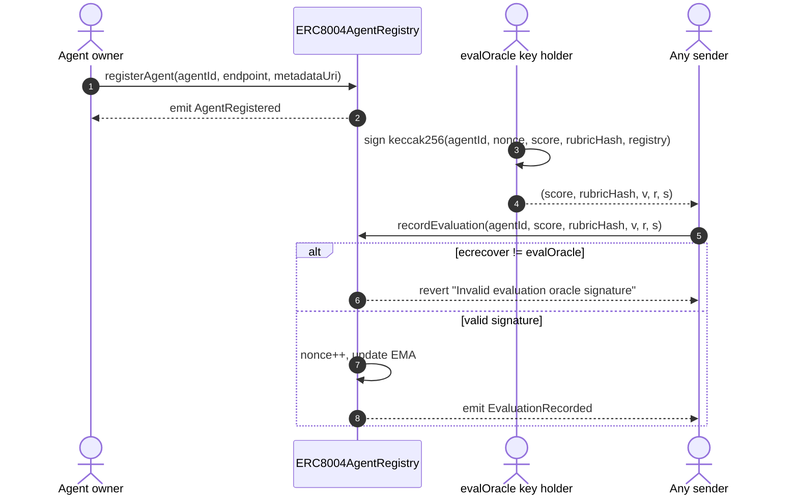
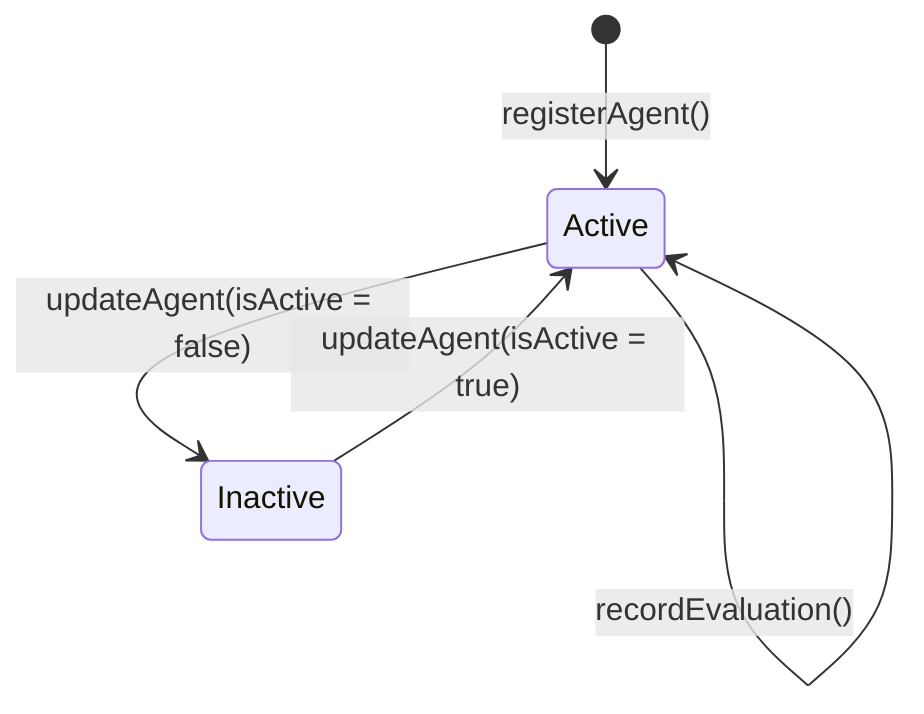

# ERC-8004 Agent Reputation Registry

An on-chain agent identity and reputation registry I built for The Turing Test: Mantle AI Agent Swarm Hackathon. It is one Solidity contract, a small Python helper module, and tests for both.

An agent owner registers an agent ID with an endpoint and a metadata URI. A single evaluation oracle signs scores for that agent, and the contract folds each signed score into an exponential moving average (EMA) stored on-chain. Only the oracle key can change a score, so an agent owner cannot rate their own agent.

---

## Quickstart

There is no separate demo command. The tests are the demo.

```bash
git clone https://github.com/manderson240/erc8004-agent-reputation.git
cd erc8004-agent-reputation

# Solidity tests (needs Foundry)
forge test -vvv

# Python tests
uv run pytest -q
```

### Test output from my run (forge 1.9.0)

```text
Ran 6 tests for test/ERC8004AgentRegistry.t.sol:ERC8004AgentRegistryTest
[PASS] testFuzz_EvaluationEMA(uint256,uint256) (runs: 256, μ: 214710, ~: 215204)
[PASS] test_RecordMultipleEvaluationsEMA() (gas: 213138)
[PASS] test_RecordSingleEvaluation() (gas: 158716)
[PASS] test_RegisterAgent() (gas: 35746)
[PASS] test_RevertOnInvalidOracleSignature() (gas: 65960)
[PASS] test_RevertOnUnregisteredAgent() (gas: 37745)
Suite result: ok. 6 passed; 0 failed; 0 skipped; finished in 15.26ms (16.57ms CPU time)
```

```text
$ uv run pytest -q
...                                                                      [100%]
3 passed in 0.01s
```

The fuzz gas mean changes slightly from run to run, and timing depends on the machine.

---

## How it works

### The contract: [`src/ERC8004AgentRegistry.sol`](src/ERC8004AgentRegistry.sol)

- `constructor(address _evalOracle)` stores the oracle address as `immutable` and makes the deployer `admin`.
- `registerAgent(agentId, endpoint, metadataUri)` stores a new `Agent` record owned by `msg.sender`. It rejects a zero ID and an ID that is already taken. Anyone can register.
- `updateAgent(agentId, endpoint, metadataUri, isActive)` lets the owner or the admin change the endpoint, the metadata URI, or the active flag.
- `recordEvaluation(agentId, qagScore, rubricHash, v, r, s)` is the scoring path:
  1. The agent must exist and be active, and `qagScore` must be at most 10000 (basis points).
  2. It reads and increments `agentNonces[agentId]`.
  3. It rebuilds the message `keccak256(abi.encodePacked(agentId, nonce, qagScore, rubricHash, address(this)))`, adds the `"\x19Ethereum Signed Message:\n32"` prefix, and requires `ecrecover` to return `evalOracle`.
  4. The first score becomes the EMA directly. After that, `EMA = (score * 2000 + prevEMA * 8000) / 10000` (`ALPHA_BPS = 2000`, so the new score gets 20% weight).
  5. It updates `totalEvaluations`, `reputationEmaBps`, and `lastEvaluatedAt`, and emits `EvaluationRecorded`.
- `getAgent(agentId)` returns the full record.

Because the nonce is part of the signed message, a signature only works once, for one agent, on this contract address. Each update writes a fixed number of storage slots, so its gas cost does not grow with the number of past evaluations.

### The Python helpers: [`sdk/agent_reputation.py`](sdk/agent_reputation.py)

`ERC8004ReputationClient` is an off-chain helper. It does not connect to a chain or sign anything.

- `create_agent_manifest` builds a JSON metadata dict (name, description, capabilities, version, timestamp).
- `compute_updated_ema` uses the same integer formula as the contract, so it gives the same result for scores in 0 to 10000.
- `generate_a2ui_reputation_passport` builds an A2UI-style component dict for displaying an agent. Scores at or above 8500 get the "Certified Verified Agent" label, and the badge color is chosen by the 8500 and 7000 thresholds. These labels exist only in this dict; the contract has no such states.
- `compute_evaluation_digest` is a SHA-256 hash of a colon-joined string. It is **not** the message the contract verifies (see Limits).

### Scoring sequence



### Agent states

The contract only has two states for a registered agent, set by `isActive`.



---

## Configuration

The code reads no environment variables. The settings are:

| Setting | Where | Value |
|---|---|---|
| Oracle address | constructor argument `_evalOracle` | set at deploy time, cannot be changed |
| EMA weight | `ALPHA_BPS` in the contract | `2000` (20%) |
| Score scale | `BPS_DENOMINATOR` in the contract | `10000` |
| Solidity version | `foundry.toml` | `0.8.24`, optimizer on, 200 runs |
| RPC endpoints | `foundry.toml` | `mantle_sepolia`, `mantle_mainnet` |

---

## Tests

- [`test/ERC8004AgentRegistry.t.sol`](test/ERC8004AgentRegistry.t.sol), 6 Foundry tests: registration, one evaluation, two evaluations (9000 then 8000 gives an EMA of 8800), a signature from the wrong key reverts, scoring an unregistered agent reverts, and a fuzz test over two random scores (256 runs) that checks the EMA formula and that it stays at or below 10000.
- [`tests/test_reputation_sdk.py`](tests/test_reputation_sdk.py), 3 pytest tests: manifest creation, EMA values and bounds, passport fields, and that the digest helper is deterministic.

---

## Limits

- **Not deployed.** I have only run the contract in Foundry's local test EVM. There is no deployed address on Mantle Sepolia or mainnet, and the `script/` folder is empty.
- **One trusted oracle.** Scores are only as honest as the single `evalOracle` key. There is no oracle network, no way to rotate the key, and no benchmark runner in this repo; the scores in the tests are hard-coded numbers.
- **Registration is open.** The signature check stops an owner from scoring their own agent, but anyone can register as many agent IDs as they like.
- **Admin power.** `admin` can change or deactivate any agent, and there is no function to transfer the admin role.
- **No chain ID in the signed message.** The message binds the contract address but not `block.chainid`.
- **The Python digest does not match the contract.** `compute_evaluation_digest` uses SHA-256 over a string, while the contract checks keccak256 over packed values. The SDK cannot produce a signature the contract accepts. Only the EMA calculation matches.
- **Not checked against the ERC-8004 draft.** I named this after the ERC-8004 agent identity idea, but I have not compared it to the draft EIP's interfaces. It uses its own function names and should not be treated as a conforming implementation.
- **No identity token.** An agent is a mapping entry, not an NFT or soulbound token.

---

## Deployment

I have not deployed this yet. With Foundry, a deploy to Mantle Sepolia would look like this:

```bash
forge create --rpc-url https://rpc.sepolia.mantle.xyz \
  --private-key $PRIVATE_KEY \
  src/ERC8004AgentRegistry.sol:ERC8004AgentRegistry \
  --constructor-args $EVAL_ORACLE_ADDRESS
```

---

## Hackathon deliverables

- Demo video: [`docs/erc8004_reputation_demo.mp4`](docs/erc8004_reputation_demo.mp4), generated with `python3 scripts/generate_pitch_video.py`

## License

MIT
