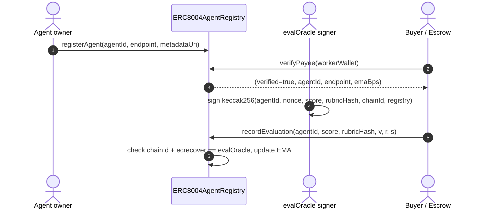

# ERC-8004 Agent Reputation Registry

An on-chain agent identity, Confirmation of Payee lookup, and reputation registry designed for Mantle and Aevum Builder Challenge #1 (Build 51828, Track 4 Confirmation of Payee integration).

An agent owner registers an agent ID with an endpoint and a metadata URI. A designated evaluation oracle (`evalOracle`) signs QAG quality scores for that agent, and the contract folds each signed score into an exponential moving average (EMA) stored on-chain (`ALPHA_BPS = 2000`, 20% weight per update). The signed message binds `(agentId, nonce, qagScore, rubricHash, block.chainid, address(this))`, blocking cross-chain and duplicate-nonce replay. Callers or payment escrows can call `verifyPayee(address)` for pre-flight Confirmation of Payee verification before transferring funds.

---

## Quickstart

```bash
git clone https://github.com/manderson240/erc8004-agent-reputation.git
cd erc8004-agent-reputation

# Compile with Shanghai EVM and verify zero Cancun opcodes
forge build --force && python3 scripts/check_shanghai.py

# Solidity tests (needs Foundry)
forge test -vv

# Python tests (Solidity keccak digest parity + ECDSA signing/recovery + EMA)
uv sync --all-extras
uv run pytest -q
```

### Verified test results from my run

```text
$ forge build --force && python3 scripts/check_shanghai.py
OK: 2 bytecode blobs verified Shanghai-safe.

$ forge test -vv
Ran 9 tests for test/ERC8004AgentRegistry.t.sol:ERC8004AgentRegistryTest
[PASS] testFuzz_EvaluationEMA(uint256,uint256) (runs: 256, μ: 219250, ~: 219677)
[PASS] test_AdminAndOracleRotation() (gas: 112436)
[PASS] test_RecordMultipleEvaluationsEMA() (gas: 217593)
[PASS] test_RecordSingleEvaluation() (gas: 160953)
[PASS] test_RegisterAgent() (gas: 35785)
[PASS] test_RevertOnInvalidOracleSignature() (gas: 68214)
[PASS] test_RevertOnUnregisteredAgent() (gas: 37800)
[PASS] test_RevertOnWrongChainIdSignature() (gas: 70474)
[PASS] test_VerifyPayeeActiveInactiveAndUnknown() (gas: 105545)
Suite result: ok. 9 passed; 0 failed; 0 skipped; finished in 17.10ms (23.05ms CPU time)

$ uv run pytest -q
....                                                                     [100%]
4 passed in 0.45s
```

---

## How it works

### Contract: [`src/ERC8004AgentRegistry.sol`](src/ERC8004AgentRegistry.sol)

- `registerAgent(agentId, endpoint, metadataUri)` registers an active `Agent` record owned by `msg.sender` and sets `ownerToAgentId[msg.sender]` if unset (`setPayeeAgent` lets multi-agent owners choose a primary payee ID).
- `verifyPayee(address payee)` returns `(verified, agentId, endpoint, metadataUri, reputationEmaBps, totalEvaluations)` so wallets and escrows (such as `AevumAgentEscrow`) can verify recipients before payment.
- `recordEvaluation(agentId, qagScore, rubricHash, v, r, s)` verifies `ecrecover` over `keccak256(abi.encodePacked(agentId, nonce, qagScore, rubricHash, block.chainid, address(this)))` with EIP-191 prefix against `evalOracle`, increments `agentNonces[agentId]`, and updates `reputationEmaBps`.
- `setEvalOracle(newOracle)` and `transferAdmin(newAdmin)` allow admin-gated oracle key rotation and ownership transfer.

### Python SDK: [`sdk/agent_reputation.py`](sdk/agent_reputation.py)

- `compute_evaluation_digest(agent_id, score, rubric_hash, nonce)` computes the byte-identical `Web3.solidity_keccak` digest expected by `recordEvaluation`.
- `sign_evaluation(...)` and `recover_oracle_signer(...)` sign and verify EIP-191 oracle proofs using `eth_account`.
- `verify_payee_rpc(rpc_url, payee_address)` queries `verifyPayee(address)` over JSON-RPC.
- `compute_updated_ema(...)` and `generate_a2ui_reputation_passport(...)` compute the matching integer EMA and emit an A2UI 1.0 reputation passport card.



---

## Deployment (Aevum Challenge #1 / Build 51828)

`foundry.toml` targets `solc_version = "0.8.24"` with `evm_version = "shanghai"` because QDay Aevum Testnet (Chain ID `44005`, RPC `https://rpc-test.qday.info`) runs the Shanghai EVM and requires `--legacy` Type-0 transactions. `scripts/check_shanghai.py` scans the compiled `src/` artifacts and confirms `2` bytecode blobs contain zero Cancun-only opcodes (`BLOBHASH`, `BLOBBASEFEE`, `TLOAD`, `TSTORE`, `MCOPY`).

`script/DeployERC8004.s.sol` deploys `ERC8004AgentRegistry` using either an encrypted Foundry keystore (`cast wallet new aevum-deployer`) or `.env` from `.env.example`:

```bash
# 1. Verify Shanghai EVM bytecode safety (no MCOPY/TLOAD/TSTORE/BLOB* opcodes)
forge build --force && python3 scripts/check_shanghai.py

# 2. Create an encrypted Foundry keystore (recommended)
cast wallet new aevum-deployer

# 3. Deploy to QDay Aevum Testnet (Chain ID 44005, Type-0 legacy tx)
forge script script/DeployERC8004.s.sol:DeployERC8004 --rpc-url aevum --broadcast --legacy --account aevum-deployer

# Optional fallback using PRIVATE_KEY and AEVUM_RPC_URL from .env
forge script script/DeployERC8004.s.sol:DeployERC8004 --rpc-url "$AEVUM_RPC_URL" --broadcast --legacy
```

QDay's starter kit notes that QDay's internal ERC-8004 registry is still in internal testing and not open for Aevum Builder Challenge #1, so this contract provides a self-deployable ERC-8004 registry and `verifyPayee(address)` endpoint on Aevum Testnet (`44005`, explorer https://explorer-test.qday.info). All Foundry checks (`9/9` pass) and Shanghai bytecode checks (`2` blobs verified) pass, and `ERC8004AgentRegistry` is now **deployed live on QDay Aevum Chain `44005`**:

- **Live `ERC8004AgentRegistry` (Chain 44005)**: [`0x4595b33f41723c6f70F60adf05A69c8D2AB978e2`](https://explorer-test.qday.info/address/0x4595b33f41723c6f70F60adf05A69c8D2AB978e2)
- **Exact Deployed Source Commit** (because Aevum Blockscout source verification is temporarily offline): [`src/ERC8004AgentRegistry.sol` @ `86e2bc1`](https://github.com/manderson240/erc8004-agent-reputation/blob/86e2bc1f49b52a05000d1218b528381dcce5c873/src/ERC8004AgentRegistry.sol)
- **Deployer & `evalOracle`**: `0x030e513B96A0B419942f4D6ECB250f172344585e`
- **Deployment CREATE Tx**: [`0xfbf843e0c4b3cb807872fabca096f8883bd3413d81dc193675af703163f2670d`](https://explorer-test.qday.info/tx/0xfbf843e0c4b3cb807872fabca096f8883bd3413d81dc193675af703163f2670d)
- **Live Agent Registration**: Registered payee `agentId` `0x2c7fb9c0b01fe7e7c8a2bba8097381ca1ffb43a320301373c1633b9792c65fda` ([`0x0de99e26e50d436f849b026b6ba5555b9a2a7b0ab46cded74f986c5efeec2c1d`](https://explorer-test.qday.info/tx/0x0de99e26e50d436f849b026b6ba5555b9a2a7b0ab46cded74f986c5efeec2c1d), block `4118216`)
- **Live EIP-191 `recordEvaluation` Tx**: Recorded score `9200` bps (`92.00%`, rubric `TASK-AEVUM-LIVE-1795639978-QAG-RUBRIC-V1`) on-chain ([`0x5226bbb51ed1a408021195f07b7070a795632a67b8b87a5418e75d786e7a9d31`](https://explorer-test.qday.info/tx/0x5226bbb51ed1a408021195f07b7070a795632a67b8b87a5418e75d786e7a9d31), block `4119030`, `gasUsed: 125216`), updating `verifyPayee` to `reputationEmaBps = 9200`, `totalEvaluations = 1`.
- **Wired `AevumAgentEscrow`**: [`0xFF26781D65a8D7589699B6bcd4Cb137Bf67A7d64`](https://explorer-test.qday.info/address/0xFF26781D65a8D7589699B6bcd4Cb137Bf67A7d64) (CREATE Tx [`0x456d4103...`](https://explorer-test.qday.info/tx/0x456d4103e6c983dbcb3519dbd363428345fc0d8da48b3ca93fb135284eee461a), `setPayeeRegistry` Tx [`0xe5c10a87...`](https://explorer-test.qday.info/tx/0xe5c10a87ddda1a661ab4f0df5899cfdd0c4224177ec9558cccce78c9993e5d51)).

---

## Hackathon deliverables

- Demo video (`170.52s`, under 3 minutes, 2560x1440 QHD): [erc8004_reputation_demo.mp4](https://raw.githubusercontent.com/manderson240/erc8004-agent-reputation/main/docs/erc8004_reputation_demo.mp4) ([`docs/erc8004_reputation_demo.mp4`](docs/erc8004_reputation_demo.mp4), generated with `python3 scripts/generate_pitch_video.py`, `ffprobe` duration `170.522031s`, size `16225773` bytes)
- Third-party notices: [`NOTICE.md`](NOTICE.md)

## Future Roadmap

- Add multi-oracle quorum aggregation across specialized evaluation signers while preserving single-slot EMA storage cost.
- Migrate or bridge registered agent identities and EMA scores once QDay opens its official ERC-8004 registry from internal testing, and prepare Q1 2027 QDay mainnet support.

## License

MIT (see [LICENSE](LICENSE) and [NOTICE.md](NOTICE.md))
