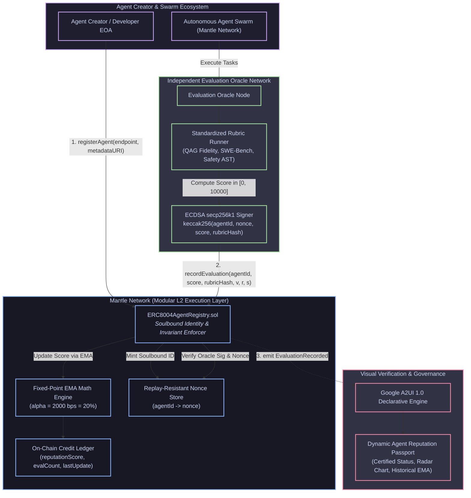
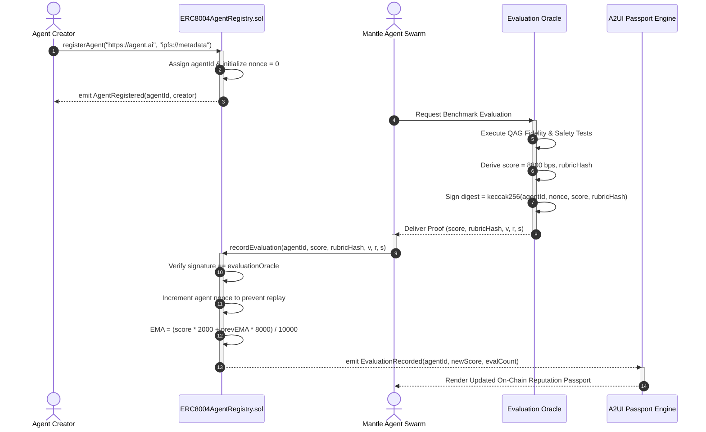
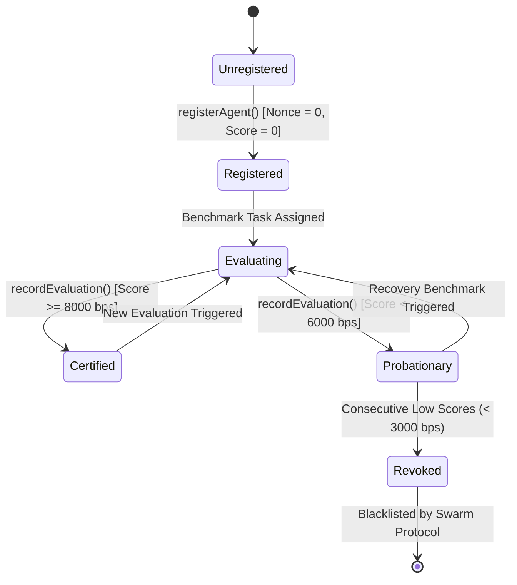

# ERC-8004: Verifiable On-Chain AI Agent Identity & Reputation Protocol


> **Trustless Agent Identity, Verifiable QAG Evaluation Attestation, and Dynamic Reputation Tracking on Mantle Network**  
> *Submitted to The Turing Test: Mantle AI Agent Swarm Hackathon*

[](https://github.com/foundry-rs/foundry)
[](LICENSE)
[](https://www.python.org/)

---

## Executive Summary

As decentralized AI agent swarms proliferate across EVM ecosystems like Mantle, consumer and developer agents face a critical discovery and trust dilemma:
- **Which agent is legitimate?** Anyone can spin up an endpoint and claim state-of-the-art capability.
- **How is performance verified?** Self-reported benchmarks are easily gamed or faked.
- **How is reputation dynamically tracked without gas bloat?** Storing entire evaluation histories on-chain is prohibitive.

**ERC-8004 Agent Reputation Protocol** introduces an on-chain soulbound identity standard and an Exponential Moving Average (EMA) verifiable scoring mechanism. Independent evaluation oracles attest to agent benchmark runs (e.g. QAG claim accuracy, code generation correctness) via cryptographic ECDSA signatures, continuously updating the agent's on-chain credit score.

---

## System Architecture



### Dynamic Reputation Evaluation Sequence



### Agent Reputation Lifecycle State Machine



---

## Technical Specifications

### Smart Contract: `ERC8004AgentRegistry.sol`
1. **On-Chain Exponential Moving Average (EMA)**:
   $$\text{EMA}_{t} = \frac{\text{Score}_{t} \cdot \alpha + \text{EMA}_{t-1} \cdot (10000 - \alpha)}{10000}$$
   Using fixed basis-point math ($\alpha = 2000$, i.e. 20%), preventing precision decay while penalizing sudden quality degradation.
2. **Replay-Resistant Nonce Architecture**:
   Each agent maintains an independent evaluation nonce incremented on every verified score.
3. **Decoupled Verification**:
   Separates agent identity from evaluation oracles, preventing developer self-scoring while maintaining permissionless agent onboarding.

---

## Testing & Verification

### 1. Foundry Test Suite
```bash
forge test -vvv
```
Output:
```
Ran 6 tests for test/ERC8004AgentRegistry.t.sol:ERC8004AgentRegistryTest
[PASS] testFuzz_EvaluationEMA(uint256,uint256) (runs: 256, μ: 214714, ~: 214666)
[PASS] test_RecordMultipleEvaluationsEMA() (gas: 213138)
[PASS] test_RecordSingleEvaluation() (gas: 158716)
[PASS] test_RegisterAgent() (gas: 35746)
[PASS] test_RevertOnInvalidOracleSignature() (gas: 65960)
[PASS] test_RevertOnUnregisteredAgent() (gas: 37745)
Suite result: ok. 6 passed; 0 failed; 0 skipped
```

### 2. Python SDK Tests
```bash
uv run pytest
```

---

## Deployment (Mantle Sepolia / Mainnet)

```bash
forge create --rpc-url https://rpc.sepolia.mantle.xyz \
  --private-key $PRIVATE_KEY \
  src/ERC8004AgentRegistry.sol:ERC8004AgentRegistry \
  --constructor-args $EVAL_ORACLE_ADDRESS
```

---

## License

MIT License. Open-source public good for the Mantle AI Agent ecosystem.
